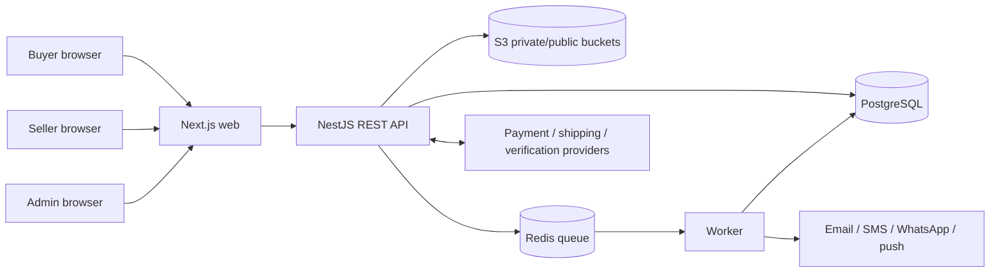

# System architecture

The implemented repository layout is documented in [project-structure.md](project-structure.md). `apps/web` and `apps/api` are separate applications; API code is organized into NestJS feature modules. Some infrastructure choices below remain proposals until their workflows are implemented.

## Context and choice

The initial `E:/multi-vendor` workspace was empty. The project now uses Next.js, NestJS, PostgreSQL and Prisma in a **TypeScript modular monolith** with explicit feature boundaries. PDF p. 9 also suggests S3 storage and Redis queues; those integrations remain future work.

| Layer | Recommendation | Why / trade-off |
|---|---|---|
| Buyer UI | Next.js | SEO, server-rendered catalog/CMS pages, routing, image optimization. Added server runtime and caching complexity. |
| Seller/Admin UI | Same Next.js codebase, separate route groups/layouts | Shared types and UI primitives, one deployment initially. Require middleware plus API authorization; route isolation alone is insufficient. Can split later. |
| REST API | NestJS on Node.js | Modules, dependency injection, validation and test structure suit broad domain. Express is lighter but requires more conventions; NestJS is a proposal, not a PDF mandate. |
| Database | PostgreSQL | Strong transactions, partial indexes, JSONB where useful, mature tooling. MySQL is viable, but PostgreSQL's constraints aid finance and inventory workflows. |
| ORM | Prisma plus targeted SQL migrations where required | Typed queries/schema and fast solo iteration. Some partial indexes, exclusion/advanced constraints and complex reports need SQL. Prisma migrations must be reviewed. |
| Jobs | Redis-backed queue (BullMQ) | Retryable notifications, imports, webhook follow-up and reconciliation. Initial development may use a worker in the same repository, deployed separately. Redis is not a financial source of truth. |
| Files | Private S3-compatible object storage | Signed uploads/downloads, durable media/documents. Public product images may be CDN cached; seller KYC documents must stay private. |

## Repository layout (planned, not created)

```text
apps/web/                Next.js buyer, seller, admin routes
apps/api/                NestJS REST API and modules
apps/worker/             queue consumers and scheduled reconciliation
packages/contracts/     validated request/response types and enums
packages/ui/            shared design primitives if reuse proves useful
docs/                   approved product and engineering contracts
```

Avoid a `packages/ui` package until actual sharing warrants it. Keep module ownership clear: identity, sellers, catalog, inventory, cart, pricing/promotions, checkout/orders, payments/wallet, shipping, returns/refunds, settlements, CMS/SEO, support, notifications and audit. Modules communicate via application services and durable events/outbox, not direct cross-module table writes.

## Runtime and data flow



One canonical API owns business logic. Next.js may render catalog data server-side but must call the same domain layer/API. Provider adapters normalize external statuses; raw webhook payloads are retained with signature verification and idempotent processing. All money and inventory commitments are recorded in PostgreSQL transactions. Use a transactional outbox for tasks that must be dispatched after commit. Read models and analytics can be added later.

## Key flows

1. Seller registers, verifies contact, submits business/GST/bank/document data; verification evidence is stored; admin approves; shop can publish approved products.
2. Buyer checkout reprices the server-side cart, validates coupon/stock/COD/shipping, creates one parent order and one seller order per seller, reserves stock and creates payment intent within a safe transaction boundary. Confirm payment only from verified provider evidence; release reservations on failure/expiry.
3. A seller order moves through fulfillment independently. Shipping adapter generates label/tracking, webhooks update shipment events, and delivery evidence starts return/settlement eligibility according to approved policy.
4. Return request, review, pickup/QC, refund and seller adjustment are separate auditable state machines. Payouts are computed from immutable financial entries and reconciled before marking paid.

## Operational baseline

- Environments: local, staging, production; separate provider credentials, buckets and databases; `.env.example` when code is introduced.
- CI: formatting/lint, type check, unit and integration tests, migration check, build. Apply production migrations with backup/rollback plan.
- Observability: structured logs with request/correlation IDs, metrics and alerts for checkout failures, webhook lag, queue failures and payout discrepancies. Never log credentials or full bank details.
- Backups: encrypted database backups with restore drill; object versioning/retention per policy.
- Performance targets, traffic volume, hosting region and budget are undecided; select infrastructure sizing after those are supplied.

## Decisions needing approval

See `development-roadmap.md` decision register. Technology choices above are recommendations. The PDF does not specify hosting, payment provider, currencies, tax ownership or settlement policy.
