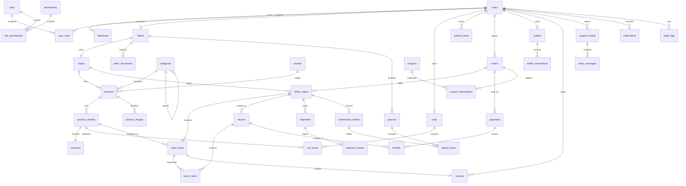

# Entity relationship diagram (logical)

This is the proposed normalized model, not a committed migration. `database-schema.md` defines columns and constraints. Seller isolation follows `shop_id`/`seller_id` ownership, never a client-supplied seller filter alone.

Additional reference/configuration relationships: category attributes and variant option values; promotions and coupon scopes; locations/zones/shipping rules/tax rules; CMS pages/blogs/media; payment and webhook events; OTP challenges and refresh sessions; bank verification; inventory movements/reservations; wallet ledger, payout ledger and provider reconciliations. These are detailed in the schema and added only where a workflow requires separate lifecycle/history.

## Multi-seller invariant

`orders` is the buyer-facing checkout aggregate. Each `seller_orders` row belongs to exactly one `orders` row and one `shops` row. Each `order_items` row belongs to a seller order and references a variant for provenance, while storing immutable product/variant/title/SKU/HSN/price/tax snapshots. A cart may contain variants from many shops; order and seller-order totals must reconcile. Payment may be order-level; fulfillment, returns, commissions and payouts are seller-order/item-level.
